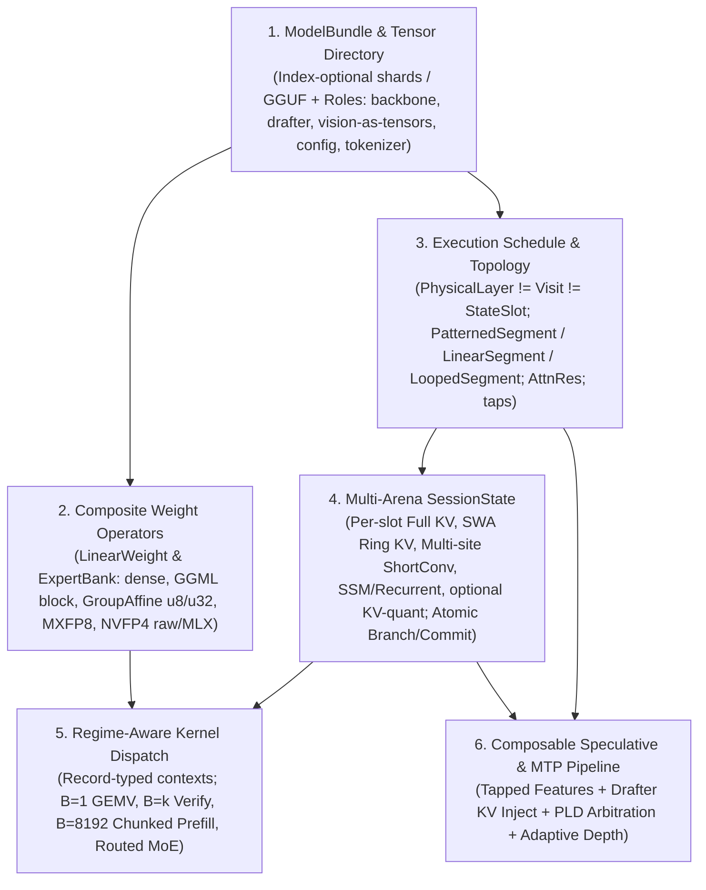

# Gradus Flexible Inference & Weight Format Architecture

**Status**: ACTIVE — revised post-implementation audit (2026-11-26)
**Date**: 2026-11-24
**Revision**: local-library stress test (2026-11-24) + secondary implementation audit & Radix compiler alignment (2026-11-26)
**Scope**: `gradus/` model admission, multi-format quantized weight representation, execution graph topology, heterogeneous session state, and speculative/MTP decoding.
**Supersedes / Contextualizes**:
- [`numeric-flexibility-performance.md`](numeric-flexibility-performance.md) (2026-08-18, pre-`gpu-reset`)
- [`gi4-contract.md`](gi4-contract.md) (2026-08-18, pre-`gpu-reset`)
- [`../factory/mlx-support/CAMPAIGN.md`](../factory/mlx-support/CAMPAIGN.md) (2026-08-21, deferred behind `gpu-reset`)
- [`../factory/speculative-decode/CAMPAIGN.md`](../factory/speculative-decode/CAMPAIGN.md) (2026-08-21, token-only `context_lookup` scope)

---

## 1. Context: Why the August 2026 Design Docs Are Out of Date

The earlier documents in `docs/design/` were authored in August 2026 against a compiler/runtime boundary (`CollectionKernelPlan` recipe enums in `radix-mir`, per-format Rust emitters in `quantized_matmul.rs`, Latin source syntax, and GI3/GI4 host partition ledgers) that has since changed fundamentally:

1. **The `gpu-reset` Architecture (Sept–Nov 2026)**:
   - **Rule 17 ("formats live in Gradus, never in the compiler")**: Quantized layouts and decode math belong in pure Faber source under `gradus/`, not as a closed `PackedStorageLayout` enum inside Radix. [`src/quant/q8_0.fab`](../../src/quant/q8_0.fab) establishes the first post-reset block genus (`class Q8_0 { f16 d; list<i8, size 32> qs }`) intended for zero-copy `bytes ↦ tensor<Q8_0, [N]> via Le`.
   - **First-class `kernel` functions & KIR**: Device kernels are ordinary shape-generic Faber `kernel` functions (`size D, size QD, ...`) lowered through KIR to portable Cranelift CPU and Metal GPU code with implicit residency.
   - **Streaming zero-allocation Metal decode (~9.5 ms/tok)**: [`src/decode_step.fab`](../../src/decode_step.fab) and [`src/decode_token.fab`](../../src/decode_token.fab) prove high-speed native execution using pre-primed scratch buffers (`prime1`/`prime2`), fused QKV and gate+up projections, split-K attention context, and multi-row in-place KV writes.
2. **Surface Modernization**:
   - English locale (`locale = "en"`), typed trap outcomes, retirement of legacy `src/train.fab`, and the [`gradus-clean-break`](../factory/gradus-clean-break/CAMPAIGN.md) migration from fixed `_2x2`/`_4x4` wrappers to shape-generic `tensor<T, [...]>` signatures.

---

## 2. Audit of Current `gradus/` Seams and Friction Points

Today, `gradus/` contains strong foundational pieces that sit in **parallel, unconnected worlds**:

### 2.1 Weight Formats & Model Admission
- **Open storage vs. single-block device structs**:
  - [`src/storage.fab`](../../src/storage.fab) models open-world `EncodedStorage` (`Representation` + `BlockMetadata` + `list<b8>`), and [`src/model/dequant.fab`](../../src/model/dequant.fab) decodes GGML `{F32, F16, BF16, Q5_0, Q8_0, Q4_K, Q5_K, Q6_K}` to host `list<f32>`. Resident GGUFs already require **`Q4_1`** (Flint) and **`IQ4_NL`** (Inkling) on top of that set.
  - [`src/quant/q8_0.fab`](../../src/quant/q8_0.fab) models self-contained 34-byte GGML blocks for device kernels (currently module-private pending Radix's `BoundedArray` export support in `file_interface.rs`).
  - **Gap**: Neither model represents **multi-tensor / planar quantization** where packed weights, group scales, group zero-points/biases, per-expert `amax`, or tensor-wide denominators live in **separate sibling tensors** (MLX affine, GPTQ, AWQ, MXFP8, NVFP4), nor **heterogeneous per-module quantization** within the same layer. The same logical operator also appears as **several physical sibling-set encodings** (raw ModelOpt NVFP4 vs. MLX-converted U32/`global_scale` vs. GGML `IQ4_NL` blocks).
- **Single-file GGUF bias in capsules and adapters**:
  - [`src/model/capsule.fab`](../../src/model/capsule.fab) (`capsule-schema-2.0.0`) binds **one** `artifact.ContentIdentity` (a single file) to `GgufManifest | SafetensorsManifest`.
  - [`src/model/safetensors.fab`](../../src/model/safetensors.fab) `header()` already treats N as JSON-only length and starts data at `8 + N`; `admit` is format-generic (`TENSOR_LIMIT` 65536). Remaining gaps are whole-file buffering, single-file identity, and an F32-centric fixture/oracle. The August `mlx-support` campaign still describes the retired 5-tensor stub and header-length bug.
  - [`src/model/dense_llama.fab`](../../src/model/dense_llama.fab), [`src/model/dense_qwen2.fab`](../../src/model/dense_qwen2.fab), and [`src/model/qwen35moe.fab`](../../src/model/qwen35moe.fab) hardcode **frozen single-checkpoint dimensions** (e.g., SmolLM2-360M or 753-tensor Qwen3.5-MoE) and query `GgufManifest` directly rather than binding against a container-neutral config + tensor directory.

### 2.2 Inference Topologies & Execution Stacks
Gradus currently has **three separate forward/decode stacks**:
1. **CPU Reference Carrier Stack** ([`src/model/dense.fab`](../../src/model/dense.fab) + [`src/generation/dense.fab`](../../src/generation/dense.fab)): Operates on runtime-shaped `tensor.NumericBlock` (`list<f32>`) via `(canonical_name, layer) → NumericBlock` resolvers and `list<kv.KVCache>`.
2. **Fast Device Kernel Stack** ([`src/decode_token.fab`](../../src/decode_token.fab) + [`src/decode_step.fab`](../../src/decode_step.fab) + [`src/kernel.fab`](../../src/kernel.fab)): Operates on static/shape-generic `tensor<f32, [...]>` device buffers, hardcoded to a **dense GQA + RoPE + SwiGLU F32** layer (`decode_token.layer_wide` takes **38 positional arguments**).
3. **Component-Only MoE & Hybrid State Stack** ([`src/model/moe.fab`](../../src/model/moe.fab) + [`src/model/qwen35moe_state/`](../../src/model/qwen35moe_state/session.fab)): Implements `ConvState`, `RecurrentState`, `KeyValueState`, `HybridSession`, Gated DeltaNet linear attention, and top-$k$ MoE routing over `NumericBlock`, unconnected to `generation/decoder` or `decode_step` kernels.

---

## 3. Architectural Forcing Functions

To avoid designing abstractions that only fit yesterday's Llama/Qwen2 dense checkpoints, Gradus uses two co-equal upper bounds from the operator's local library. **Inkling-2-Mini** forces loops, depthwise residuals, native/converted FP4/FP8, vision-in-backbone, and coupled MTP. **Flint INT4** forces per-layer pattern tables, inverted RoPE, learnable softmax, U8 affine packing, unindexed shards, and native KV-quant as a model-declared arena. If both express cleanly, dense, MoE, hybrid SSM, hybrid SWA, and uniformly quantized models fall out as degeneracies.

### 3.1 Inkling-2-Mini (`inkling2_loop` + `DSpark`)

Local artifacts (2026-11-24): raw HF (`thinkingmachines/Inkling-2-Mini`), MLX-8bit / MLX-4bit packs, GGUF `IQ4_NL` (17.6 GB, architecture `inkling2_loop`), and standalone DSpark GGUF `dspark-Inkling-2-Mini-Q8_0.gguf` (architecture `dflash`).

#### Six exotic mechanisms

1. **Looped Middle Core (`24` physical layers → `48` execution visits & `48` state slots)**:
   - `loop_config`: `{ core_start: 6, core_end: 18, num_passes: 3, gate_rank: 64, is_varloop: false }`. The GGUF manifest stores the same facts as `inkling2_loop.loop.{start,end,count,gate_rank,varying}`.
   - **Prelude (`layers 0..5`)**: 6 visits, producing `prelude` state and `prelude_blocks` residual bank.
   - **Looped Core (`layers 6..17`, 3 passes = 36 visits)**:
     - Pass 0 runs layers `6..17` from `prelude`.
     - Passes 1 and 2 **reset `cur` and `blocks` back to `prelude` and `prelude_blocks`** (not the output of pass $p-1$!). Pass $p-1$'s intermediate blocks and final output become `prev_pass_bank`.
     - At each core layer in pass $p > 0$, learned queries (`loop_msg_query`) attend over `prev_pass_bank` to synthesize **4 cross-pass messages** (`Q`, `K`, `V`, `FFN`), which are gated into the current pass's inputs via rank-64 `tanh` gain/forget controllers: $(1 - \tanh(\text{forget})) \odot \text{cur} + \tanh(\text{gain}) \odot \text{msg}$.
     - **Shared weights, isolated state**: All 3 passes share physical layer weights `6..17`, **but each pass owns distinct KV-cache and ShortConv state slots** ($24 + 2 \times 12 = 48$ state slots). `is_varloop` also permits variable pass counts.
   - **Coda (`layers 18..23`)**: 6 visits starting from pass 2's output ($6 + 36 + 6 = 48$ total visits).

2. **Depthwise Block Attention Residuals (`AttnRes`)**:
   - Every `n_layers_per_attn_res_block = 6` visits pushes a completed residual block onto a depthwise `blocks` list.
   - Before every Attention sublayer, every MoE FFN sublayer, and the final `output_norm`, the model executes **scaled dot-product softmax attention across the depth axis** (`mix(blocks, cur, query)`) over all prior block states plus `cur`.
   - Full-attention layers use **3 separate depth queries** (`[D, 3]`) and **3 separate input RMSNorms** so `Q`, `K`, and `V` each attend to a distinct mixture of earlier layers. Other visits carry a rank-1 query `[D]`.

3. **Zero-RoPE Hybrid SWA/Full Attention + Multi-Site Causal Short Convolutions**:
   - **20 Sliding-Window (`1024`) physical layers + 4 Full-Attention (`1M` ctx) physical layers** (`5, 11, 17, 23`). Expanded across the 3 loop passes, `40` state slots use SWA (`1024`) and only `8` slots use full-context KV.
   - **No RoPE**: Position comes from learned **projected relative-position biases** (`W_rel` projected onto `[d_rel=16, rel_extent=1024]` and gathered by relative distance), **log-position scaling $\tau$** on full-attention `Q` and `R`, **input-dependent attention sinks** (`sink_proj`), **L2 norm clipping** on `Q`, `K`, and `R`, **parameterless RMSNorm on `V`**, and a **sigmoid output gate** (`wqkv_gate`). GGUF records `inkling2_loop.rope.dimension_count = 0`.
   - **4 Causal Short Convolutions (`kernel = 4`) per visit**: Applied to `K`, `V`, post-attention, and post-FFN (`6,656` total conv channels per slot, rolling `3`-token state). Full-attention layers additionally apply **input-dependent dynamic convolution taps** (`k_sconv.weight_proj`, `v_sconv.weight_proj`). Resident conv weights are `[C, K, 1]` BF16.

4. **Sparse MoE (`128` routed, top-`8`, `0` shared) + Softcaps + Padded Vocab**:
   - Sigmoid gating + learned `e_score_correction_bias` + `route_scale = 8.0`.
   - Softcapped gated activation (`SITU`: `mlp_gate_softcap = 4.0`, `mlp_up_softcap = 25.0`) and `tanh` final logit softcapping (`30.0`).
   - Physical `embed` / `unembed` tensors are padded to `201,024` rows for hardware alignment, then sliced to `unpadded_vocab_size = 200,058` valid tokenizer rows after `lm_head`.

5. **Extreme Heterogeneous Multi-Companion Weight Formats** — one logical model, three physical encodings:

   | Checkpoint | L0–19 experts | L20–23 experts | Attn / embed / `lm_head` |
   | --- | --- | --- | --- |
   | Raw HF | `w13_weight` + `_scale` + `_amax` + `_outer_scale_denominator` (F8_E4M3 / U8 / F32) | `w13_weight` + `_scale` only | BF16 |
   | MLX-8bit convert | `gate_up_proj.{weight,scales,global_scale}` (U32 / scales / F32) | `{weight,scales}` (U32 / U8), no `global_scale` | Affine 8-bit `U32` + BF16 scales/biases (`group_size = 64`); 178 per-tensor affine overrides on a config that still defaults `mode: nvfp4` |
   | GGUF IQ4_NL | `ffn_gate_up_exps.weight` as **IQ4_NL** blocks (40 tensors) | same flattening | Q8_0 / F32 |

   Controllers, norms, convs, biases, and depth queries stay F32/BF16, plus load-time structural transforms (interleaved vs split `w13` gate/up rows, conv1d layout, stacked cross-pass queries). MLX packs distribute tensors across `model-00001-of-00004.safetensors` + `model.safetensors.index.json` + auxiliary `mtp.safetensors`. **Vision is 422 tensors inside the backbone shards** (`model.vision_tower.*` / `model.visual.*`), not a separate file.

6. **Coupled `DSpark` / `DFlash` MTP Drafter** — two container forms of the same drafter:
   - `mtp.safetensors` (54 BF16 tensors): `fuse_weight[4,4]`, per-layer `k_proj_ctx`/`v_proj_ctx`, Markov RNN `markov_w1[201024, 256]`.
   - Standalone GGUF `dflash` (58 tensors, Q8_0/F32/BF16): architecture `dflash`, `target_layers = [5, 23, 41, 48]`, `block_size = 8`, `has_markov_context = true`, SWA pattern `[T, F, T]`. **Omits embed/unembed**; borrows them from the backbone, including the padded-vocab slice.
   - Each of the 3 MTP layers mixes the four tapped vectors (`softmax(fuse_weight)` + `dflare_norm`) to inject `K_ctx`/`V_ctx` into the drafter's own hybrid SWA/full KV cache, then runs non-causal block diffusion over `[anchor, mask_1..mask_7]`.
   - GGUF `dflash.attention.sliding_window = 1025` against config `sliding_window_size = 1024`. Ring capacity comes from the admitted artifact.

### 3.2 Flint INT4 (`model_type: "flint"`) — Co-Equal Stress Model

Local artifacts: MLX affine-4bit 5-shard pack (`RecursiveSI/flint-int4`, 22 GB) and GGUF `flint-int4-q4_1.gguf` (25 GB, architecture `flint`). Flint has **no loop, no AttnRes, no MTP, no vision**. It still fails to fit a Llama/Qwen2-shaped `for l in 0..L` with uniform RoPE and a single KV arena.

Verified facts from `config.json` / GGUF metadata / shard headers:

- **49 layers**, hidden 2048, 32 heads / 4 KV heads, `head_dim` 128, context **262,144**, vocab 150,144, **untied** embeddings.
- **Per-layer pattern tables**, not an interval: `layer_types[]` (full vs sliding), `flint.attention.sliding_window_pattern` (49 bools), `flint.attention.rope_pattern` (49 bools). Full-attn layers `{0,1,5,9,…,45,48}` have **no RoPE**; SWA layers **have RoPE** (inverted relative to Inkling's zero-RoPE everywhere).
- **Sliding window 513** (not a power of two). GGUF `flint.attention.sliding_window = 513`.
- **MoE**: 256 routed experts, top-6, **2 shared experts** (`expert_shared_count = 2`, shared FFN 1024, routed FFN 512), sigmoid gating (`expert_gating_func = 2`), `norm_topk_prob`.
- **Leading dense FFN prefix**: `mlp_only_layers = [0, 1]` / `leading_dense_block_count = 2`. Layers 0–1 still run attention (`attn_sinks`, QK-norm) and use split `ffn_{gate,up,down}` rather than expert banks.
- **Learnable softmax**: 49 `softmax_offset` tensors; `softmax_type: learnable`.
- **Attention sinks as weights** (`attn_sinks.weight` per layer) plus QK-norm (`attn_q_norm`, `attn_k_norm`).
- **Native KV quant in the model config**: `kv_key_bits = 8`, `kv_value_bits = 8`, `kv_group_size = 64`. Serving policy may keep KV quant off (Inkling M5: KV-q8/q4 regressed decode); Flint still requires a KV-quant arena *option*.
- **Weight formats**:
  - MLX pack: GroupAffine **4-bit with `U8` packed weights** + BF16 scales + BF16 biases (e.g. `down_proj.weight` `[2048, 3072]` U8 = 4-bit packed `In/2`). Config `quantization: {bits: 4, group_size: 64}`. **No `model.safetensors.index.json`**; shards are zero-based `model-00000.safetensors` … `model-00004.safetensors`.
  - GGUF: **Q4_1** × 485 + F32 × 294. Current `gradus:model/dequant` does not decode Q4_1.

### 3.3 Empirical Performance Lessons from Local M5 Max Evaluation (2026-11-23)

Measurements on M5 Max (128 GB, AC power) across `mlx-serve`, `oMLX`, and `llama.cpp` highlight critical architectural realities Gradus must respect:

| Finding | Measured Effect (M5 Max) | Architectural Implication for Gradus |
| --- | --- | --- |
| **Per-module mixed quantization** (`Affine 8-bit` on BF16 attn/embed/201k `lm_head`, keeping `NVFP4`/`MXFP8` experts) | **+24% decode** (`73.8 → 91.8 tok/s`), KLD `~0.004` | Gradus must support **mixed quantization schemes per module/tensor** without re-quantizing or expanding the whole model. |
| **Native SWA ring buffers vs. KV quantization** (`40/48` slots SWA `1024` = `32 KB/tok` in FP16) | `--kv-quant 8/4` **regressed decode by −8.6% to −10.5%** | First-class bounded **SWA ring KV arenas** save far more memory and bandwidth than blanket KV quantization, with zero dequant tax. KV-quant remains an optional per-slot arena (Flint declares it). |
| **Large prefill chunking (`8192` vs `2048`)** | Lowering chunk `8192 → 2048` **cut 8K prefill by −25%** (`2,623 → 1,978 tok/s`) | Every prefill chunk streams all 26.4B MoE expert weights once. Execution must support **large configurable chunked prefill** (`B = 8192`). |
| **Adaptive MTP depth + PLD (`--mtp --mtp-max-depth 8 --pld`)** | Pinning depth to `4` **hurt decode by −3.3%**; `mlx-serve` beat `llama.cpp` by **2.1–2.4× decode, 3.5–4.2× prefill** | Speculative drafting must support **feature-tapped MTP + weightless PLD** with **adaptive runtime draft depth**, not fixed block sizes. |

### 3.4 Local Library Census (2026-11-24)

Resident generative weights under `~/ai/` that this architecture must admit. Encoder-only, STT, and image checkpoints are recorded as explicit non-goals.

| Family | Local artifacts | Architecture |
| --- | --- | --- |
| SmolLM2-135M / 360M | MLX 8-bit, MLX 6-bit, GGUF Q4_K_M, GGUF F32, HF BF16 | dense Llama, GQA, RoPE, SwiGLU, tied embed |
| Qwen2.5 0.5B / 1.5B / 7B | GGUF Q4_K_M, HF BF16 4-shard | dense Qwen2, GQA, **QKV bias**, SWA flag present and off |
| Qwen3.6-35B-A3B | GGUF UD-Q4_K_M (21 GB) | `qwen35moe`, 40 layers, 256-ex top-8 + shared, Gated DeltaNet + full attn @ interval 4, **no NextN** in this file |
| Inkling-2-Mini | raw HF, MLX-8bit, MLX-4bit, GGUF IQ4_NL, DSpark Q8_0 | `inkling2_loop` + vision-in-backbone + DSpark |
| Flint INT4 | MLX affine 4-bit 5-shard, GGUF Q4_1 | `flint`, 49-layer hybrid SWA/full MoE |
| Qwen3-Embedding-0.6B | BF16 safetensors | Qwen3 dense used as encoder + pooling (forward-only degeneracy) |

**Out of this architecture (keep them out):** Whisper (encoder-decoder audio), MiniLM / BERT-tiny (bidirectional absolute-PE encoder), Qwen-Image / FLUX stubs. Cache-only names without weights (Kolibri-1, Qwen3.8-Flash-Next, Qwen3.8-27B) do not enlarge the first implementation; Qwen3.8 dense NextN remains in Gradus `LayerKind.Nextn` and in historical bench receipts.

GGUF “Q4_K_M” is already per-tensor mixed: SmolLM2-360M Q4_K_M is Q5_0×176 + Q8_0×17 + Q6_K×16 + Q4_K×16 + F32×65. A “uniform Q8_0” degeneracy exists; the resident Q4_K_M rows do not.

---

## 4. Proposed Target Architecture: Six Orthogonal Seams

### Seam 1: Multi-Member `ModelBundle` & Logical Tensor Directory
Replace single-file `Capsule` assumptions with a pathless, content-addressed **bundle contract**:
- **Member Roles**: `backbone`, `drafter` (e.g., `mtp.safetensors` or a `dflash` GGUF), `vision`, `config` (`config.json`), `quant_config` (`hf_quant_config.json`), `shard_index` (`model.safetensors.index.json`), and `tokenizer`.
- **Vision is a tensor-role, not always a file-role.** A missing `vision` member is valid when vision names (`model.vision_tower.*`, `model.visual.*`) resolve inside `backbone`. Inkling MLX/raw put a 23-layer ViT in the backbone shards.
- **Shard maps are index-optional.** HF `model.safetensors.index.json` is one mapper. Flint admits by enumerating zero-based `model-00000.safetensors` … `model-00004.safetensors` with no index file. GGUF is a 1-member bundle, or a 2-member bundle when a `dflash` drafter GGUF sits beside an `inkling2_loop` GGUF.
- **Standards-Correct Container Parsers**:
  - Safetensors: JSON-only N, data at `8 + N`, **range-based header inspection** (no whole-file byte buffering). Live `header()` already uses `8 + N`; the remaining work is range sources and dropping the F32-only fixture as the public contract.
  - Single-file GGUF projects `backbone`, `config`, and `tokenizer` out of the same content-addressed member.
- **Logical Tensor Directory**:
  - Maps canonical/source tensor names across shards to `(member_id, byte_offset, byte_length, raw_dtype, shape)`.
  - **The tensor directory is the source of truth for operator binding.** `config.json` / `quantization.mode` is a hint. After `mlx_lm.convert`, Inkling MLX-8bit still says `mode: nvfp4` while resident expert tensors are U32 + scales + `global_scale`.
  - Supports **cross-role tensor borrowing** (e.g., `drafter` referencing `backbone`'s `embed_tokens`, `embed_norm`, and `lm_head` without duplicating residency, including the padded-vocab slice).
  - Supports declarative **load-time structural views/transforms**. Required views from the local library:
    - Slice `vocab_size = 201024` down to `unpadded_vocab_size = 200058`.
    - `conv1d` as `[C, K, 1]` BF16 (flip/transpose as declared by the adapter).
    - Fused `w13` / `gate_up_proj` vs split `gate`/`up` (Inkling experts fused; Flint dense prefix split).
    - AttnRes queries shaped `[3, D]` on full-attn visits and `[D]` otherwise.
    - DSpark `fuse_weight` softmax mix of four taps.

### Seam 2: Composite Weight & Operator Binding (`LinearWeight` / `ExpertBank`)
Under `gpu-reset` Rule 17, Gradus owns weight representations. Because modern quantizers span multiple sibling tensors, Gradus must separate **raw storage tensors** from **logical linear/expert operators**. **One logical variant may have several physical encodings**; bind the operator from the resident sibling set, then check config.

| Operator Variant | Physical encodings (resident sibling sets) | Primary Users |
| --- | --- | --- |
| `DenseF32` / `DenseBf16` / `DenseF16` | `weight: tensor<T, [Out, In]>` (+ optional `bias`) | Norms, routers, unquantized projections, Qwen2 QKV bias |
| `GgmlBlock` | Self-contained `blocks: tensor<BlockGenus, [Out, In / B]>`. Admitted genera include the current dequant set **plus `Q4_1` and `IQ4_NL`** (`Q5_0` is already decoded; Q4_K_M rows mix Q5_0/Q8_0/Q6_K/Q4_K/F32 in one file) | GGUF models, including Flint Q4_1 and Inkling IQ4_NL |
| `GroupAffine` (MLX / GPTQ / AWQ) | Packed weights **`u8` or `u32`** + `scales` + `biases`, `bits ∈ {4, 6, 8}`, `group_size` from the artifact (typically 64). 8-bit SmolLM2/Inkling attn: `U32` + BF16 scales/biases. 4-bit Flint: `U8` packed `In/2` + BF16 scales/biases. 6-bit SmolLM2-360M MLX is a first-class row | MLX bundles, quantized non-expert layers, Flint |
| `BlockFp8` (`MXFP8`) | **Raw:** `weight: tensor<fp8_e4m3, [..., Out, In]>` + `scales: tensor<ue8m0, [..., Out / Br, In / Bc]>`. **MLX convert:** `U32` packed weight + `U8` scales (Inkling L20–23 in the 8-bit pack) | Inkling layers 20–23 experts, FP8 checkpoints |
| `DualScaledFp4` (`NVFP4`) | **Raw ModelOpt:** packed E2M1 + `fp8_e4m3` group-16 `_scale` + `f32[E]` `_amax` + `f32[1]` `_outer_scale_denominator`. **MLX convert:** `U32` weight + scales + `global_scale` (Inkling L0–19 in the 8-bit pack). **GGUF:** `IQ4_NL` / other block genera on `ffn_*_exps` | Inkling layers 0–19 experts, Blackwell/Spark checkpoints |

- **Per-Module Heterogeneity**: Each linear site in a layer record (`q_proj`, `k_proj`, `o_proj`, `experts`, `lm_head`) binds its own `LinearWeight` / `ExpertBank` value from the tensor directory. Layer 0 and Layer 20 can hold different expert quant schemes (`Nvfp4` vs `Mxfp8`) behind the same `ExpertBank` interface.
- **Dual Tier Execution**: Every variant implements (a) exact reference block/row decode for oracle testing and CPU fallback, and (b) direct packed device `kernel` contractions (`linear_matvec`, `linear_matmul`, `routed_expert_matmul`).
- **Physical Storage & Compiler Alignment (2026-11-26)**:
  - `GroupAffine` `.scales`/`.biases` support native `tensor<bf16, [...]>` device views (admitted by Radix's `Bf16` kernel cell), avoiding load-time F32 upcast on resident MLX checkpoints, alongside `f32` via `<float F>` (`radix#2572`).
  - Raw `tensor<u8, [Out, RowBytes]>` packed byte views are the live Rule-17 device ABI for GGML/FP8/FP4 until `radix#2639` (`tensor<Struct, [N]>`) lands; once `radix#2639` lands, named `gradus:quant/*` block genera replace raw-byte unpackers.
  - Index-truncating bitmasks (`& 65535`, `& 4095`, `& 1023`) are banned across all kernels; use `radix#2620` guarded bounds and `radix#2560`/`#2568` widthless dimensions so vocabs > 65k (`150k`–`248k`), `Out = 4096`, and `B = 8192` prefill remain exact.
  - Future simplification: `radix#2561` (parked language design for contiguous bit-packed `u1`–`u63` / `i2`–`i63` tensors) combined with `unsigned U` (`radix#2575`) will collapse 4/6/8-bit `GroupAffine` kernels into one logical `tensor<U, [Out, In]>` view (GGUF split-array formats remain in Gradus via `radix#2639`, and mini-floats `fp8_e4m3`/`ue8m0`/`e2m1` remain in `gradus:quant/fp_primitives`).

### Seam 3: Execution Schedule — Separating `PhysicalLayer`, `Visit`, and `StateSlot`
Eliminate the hardcoded `for l in 0..L` assumption by introducing an explicit **`ExecutionSchedule`**:
- **Three Distinct Indices**:
  1. `physical_layer_id`: Indexes into the resident `PhysicalLayer` weight table (24 for Inkling, 49 for Flint, 40 for Qwen3.6, 32 for SmolLM2-360M).
  2. `visit_id`: Monotonic step index in the forward pass; indexes **feature taps** (`target_layer_ids = [5, 23, 41, 48]`) and depthwise residual cadence (`visit_id % 6 == 0`). Equals `physical_layer_id` when there is no loop.
  3. `slot_id`: Indexes into `SessionState` so repeated passes over a physical layer mutate separate KV and conv histories. Equals `visit_id` when there is no loop.
- **Structured Control Flow Primitives**:
  1. **`PatternedSegment(start_phys, end_phys, layer_kinds[L], rope_kinds[L], ffn_kinds[L])`**: the general form. Each physical layer carries an attention kind (full / sliding / linear-SSM / none), a RoPE kind (rope / relative-bias / none), and an FFN kind (dense / routed-MoE / dense-prefix). Flint is a 49-long table. Qwen3.6 compresses to an interval (`full_attention_interval = 4`). Dense Llama/Qwen2 compresses to one kind on every layer.
  2. `LinearSegment(start_phys, end_phys)` — a `PatternedSegment` whose kinds are uniform and `visit == phys == slot` (prelude/coda, ordinary dense/MoE).
  3. `LoopedSegment(start_phys, end_phys, pass_policy, reset_to_prelude, cross_pass_controller)` — shared weights, isolated slots, supporting fixed `num_passes` in Phase 1 (`is_varloop = true` fails closed / deferred behind fixed `num_passes`).
- **Sectional / optional RoPE** is a per-layer fact, not a model-wide flag: Qwen3.6 `rope.dimension_sections = [11, 11, 10, 0]`; Flint rope-on-SWA / no-RoPE-on-full; Inkling zero-RoPE + relative bias.
- **Generalized `ResidualCarrier`**:
  - Replaces bare `tensor<f32, [T, D]>` passing with a typed carrier supporting single-stream (`Standard`), depthwise block-attention banks (`AttnResBank` for Inkling / Kimi-K3 / Zonos3, plus 4-message `tanh` `CrossPassController`: $(1 - \tanh(\text{forget})) \odot \text{cur} + \tanh(\text{gain}) \odot \text{msg}$), or multi-stream hyper-connections (`HC` for DeepSeek/GLM), plus a pre-allocated `TapBuffer` (`TapStore`) for designated `visit_id` captures. `AttnResBank`, `CrossPassController`, and `TapStore` execute as `[B, D]` device kernels (not host scalar loops), and tap indexing must unambiguously cover DSpark's `target_layers = [5, 23, 41, 48]`. Flint and Qwen3.6 use `Standard`.

### Seam 4: Multi-Arena Typed `SessionState`
Unify [`src/cache/kv.fab`](../../src/cache/kv.fab), [`src/model/qwen35moe_state/session.fab`](../../src/model/qwen35moe_state/session.fab), and [`src/prepared_state.fab`](../../src/prepared_state.fab) into a composable **`SessionState`** indexed by `slot_id`. Slot typing follows the schedule's per-layer kind. **SSM hybrid and SWA hybrid are different slot mixes**; they do not share one “hybrid” arena pair.

1. **`FullKvArena`**: Contiguous or paged KV storage up to `context_length` for global attention slots (8 of 48 Inkling slots; 10 of 40 Qwen3.6 slots; Flint full-attn layers).
2. **`RingKvArena` (Sliding Window)**: Fixed `O(window_size)` circular/ring buffer with `swa_type` masking. **Window size is a per-slot fact from the admitted artifact**: 1024 (Inkling), 513 (Flint), 1025 (dflash GGUF). Do not hardcode 1024.
3. **`ConvStateArena`**: Multi-channel rolling `(L_cache - 1)` history supporting **heterogeneous per-width conv pools** driven by `ExecutionSchedule` (e.g., Inkling's `kv_dim` `K`/`V` sites vs `hidden_dim` `post_attn`/`post_ffn` sites, and Qwen3.6's 30 DeltaNet layers) with optional dynamic per-head tap projections. `HybridTxn` journals conv pushes per `(slot, site_idx)` so `B=k` site-major writes remain atomic.
4. **`RecurrentStateArena`**: Fixed-size state matrices/vectors per sequence for linear attention (Gated DeltaNet, KDA, Mamba2) and drafter RNN heads (DSpark Markov RNN).
5. **Optional per-slot KV-quant overlay** (`kv_key_bits` / `kv_value_bits` / `kv_group_size` as in Flint). Default serving policy keeps it off when a ring already bounds memory; **`KvQuantConfig.enabled = true` must fail closed (`UnsupportedKvQuant`) until a real quantized KV arena is implemented** (never silently allocate/store F32).

**Transactional Invariant**: Checkpoint, speculative branch creation, $m$-of-$k$ accepted-prefix commit, rollback, and warm-prefix serialization (**binary LE `prepared_state` wire v2** over active rows `[0..length)` bound to `PreparedIdentity` + full `ExecutionSchedule` metadata including `conv_sites`, `conv_kernel`, and `LoopedSegment` controls) operate **atomically across every arena type present in the session**.

### Seam 5: Record-Typed Device Contexts, Composable Stages & Regime-Aware Batching
Replace the 38-argument flat signature in [`src/decode_token.fab`](../../src/decode_token.fab) and prevent per-model stack proliferation:
- **Composable Stage Primitives + Thin Per-Family Orchestrators**: Define shared device stage building blocks (`norm`, `attention`, `conv_or_deltanet`, `ffn_or_moe`) that all consume `LinearWeight`/`ExpertBank` (Seam 2), `SessionState`/`HybridSession` (Seam 4), and `ResidualCarrier` (Seam 3) inside `do device` regions. Model files (`dense`, `flint`, `qwen36`, `inkling2`, `dspark`) compose these shared stages over `ExecutionSchedule` — never copy-pasting F32-only layer pipelines.
- **Record Grouping**: Bundle parameters into `LayerWeights`, per-slot state views into `SlotView`, scalar hyperparameters into `LayerParams`, and pre-primed device scratch buffers into `Workspace<MaxBatch>`.
- **Three Execution Regimes over One Model Definition**:
  1. **Scalar Decode (`B = 1`)**: Uses split-K GEMV, fused QKV / gate+up projections, and single-row arena updates.
  2. **Small-Block Verify / MTP Diffusion (`B = k`, e.g., $k \le 16$)**: Scores $k$ candidate tokens (or evaluates `[anchor, mask_1..mask_{k-1}]` non-causally, DSpark `block_size = 8`) in a single weight read, writing into a transactional state branch.
  3. **Chunked Prefill (`B = C`, e.g., $C = 8192$)**: Tiles long prompts at large chunk sizes so 26B+ MoE expert banks stream once per chunk using compute-bound tiled/grouped GEMM (`·`), **while tiling attention score/context computation over small query blocks ($B_q$, e.g. 64–128)** so scratch stays $O(B_q \cdot H \cdot C)$ instead of $O(B \cdot H \cdot C)$, paired with $O(C)$ sink softmaxes.
- **Kernel axes the dense GQA `layer_wide` path does not express** and that record-typed layers must carry:
  - Optional QKV bias (every Qwen2.5 GGUF).
  - QK-norm (Flint, DSpark, Inkling).
  - Attention sinks as a **weight** (Flint `attn_sinks`) vs input-dependent `sink_proj` (Inkling).
  - Relative-position gather + log-τ + L2 clip + parameterless V RMSNorm + sigmoid output gate (Inkling).
  - Learnable softmax offset (Flint).
  - SITU softcapped gated activation vs SwiGLU vs GELU.
  - Dynamic conv tap projections on full-attn Inkling layers.
  - Fused `attn_qkv` (Qwen3.6 linear-attn layers) vs split Q/K/V.
  - Sectional RoPE.

### Seam 6: Composable Speculative & MTP Pipeline
Evolve [`src/speculative.fab`](../../src/speculative.fab) and [`src/draft_verify.fab`](../../src/draft_verify.fab) into **one unified `B=k` Draft-and-Verify Coordinator over `HybridTxn`** (with `SessionTxn` as the KV-only degeneracy), folding the corrective/bonus token into the next verify batch without per-step full-KV deep copies:
- **Drafter Input Context**: Supplies `(token_history, target_tap_buffer, shared_backbone_views, drafter_session_state, adaptive_budget)`.
- **Admitted Drafter Families**:
  - *Weightless*: Prompt Lookup Drafting (`PLD` / `context_lookup`) and N-gram tables.
  - *Coupled Feature-Tapped*: `DSpark` / `DFlash` / `NextN` / `EAGLE` (consuming `target_tap_buffer` to inject drafter KV context, running `decode_token.layer_batch(..., BlockDiffusion)` over `[anchor, mask_1..mask_7]` with `[T, F, T]` SWA, and projecting through `markov_w1[V, 256]` + `RecurrentStateArena` + device vocab slice). DSpark is admitted via `TensorDirectory` from both `mtp.safetensors` inside an MLX/HF bundle and a standalone `dflash` GGUF.
  - *Standalone Draft Model*: Independent small `ModelBundle` sharing only tokenizer identity.
- **Composite Policy, Adaptive Depth & Sampling**: Supports chaining (`PLD` fast-path fallback to `MTP`, with configurable `min_suffix_length` so 1-token stopwords do not preempt MTP) and **rolling-acceptance** `AdaptiveBudget` (`min_depth..max_depth`, independent PLD vs MTP budgets; default 1..8). Phase 1 is greedy-only; rejection-sampling speculative verification is Phase 2.

---

## 5. Degeneracy Check: How Local Models Map Onto These Seams

A key design test is **zero abstraction tax** on simple models. Rows below are resident in `~/ai/` unless marked historical.

| Model Archetype | `ModelBundle` (Seam 1) | `LinearWeight` (Seam 2) | `ExecutionSchedule` (Seam 3) | `SessionState` (Seam 4) | Speculative (Seam 6) |
| --- | --- | --- | --- | --- | --- |
| **SmolLM2-135M MLX-8bit** | 1-file ST + `config.json` + tokenizer | Uniform `GroupAffine` **u32** 8-bit, `group_size=64` | `LinearSegment(0..L)`, `visit == phys == slot`, `Standard` residual, no taps | `FullKvArena` × 30 | Disabled or `PLD` |
| **SmolLM2-360M GGUF Q4_K_M** | 1-file GGUF | **Mixed** `GgmlBlock` Q5_0/Q8_0/Q6_K/Q4_K/F32 | `LinearSegment`, `Standard` | `FullKvArena` × 32 | Disabled or `PLD` |
| **SmolLM2-360M MLX-6bit** | 1-file ST + config | Uniform `GroupAffine` **6-bit** | `LinearSegment`, `Standard` | `FullKvArena` × 32 | Disabled or `PLD` |
| **Qwen2.5-0.5B/1.5B GGUF** | 1-file GGUF | Mixed Q4_K/Q6_K/F32 + **QKV bias** | `LinearSegment`, `Standard` | `FullKvArena` × 24/28 | Disabled or `PLD` |
| **Qwen2.5-7B HF BF16** | 4-shard ST + index | `DenseBf16`, **untied** `lm_head` | `LinearSegment`, `Standard` | `FullKvArena` × 28 | Disabled or `PLD` |
| **Qwen3-Embedding-0.6B** | 1-file ST + pooling module | `DenseBf16` | `LinearSegment`, forward-only | none | n/a |
| **Qwen3.6-35B-A3B GGUF** | 1-file GGUF | Mixed `GgmlBlock` Q8_0/Q4_K/Q5_K/Q6_K/F32 + `ExpertBank` | `PatternedSegment` interval hybrid (`full_attention_interval=4`), 0 NextN in this file, sectional RoPE | `FullKvArena` × 10 + `ConvStateArena` + `RecurrentStateArena` × 30 (DeltaNet). No ring KV | `PLD` (NextN absent here; `LayerKind.Nextn` remains for other rows) |
| **Flint INT4 MLX / GGUF Q4_1** | 5 shards, **no index** / 1-file GGUF | GroupAffine **u8** 4-bit, or `GgmlBlock<Q4_1>`; 2 dense FFN layers + 256-ex top-6 + 2 shared | `PatternedSegment` SWA/full, inverted RoPE, learnable softmax, `leading_dense_block_count=2` | `FullKvArena` + `RingKvArena(513)`, optional KV-q8 | Disabled or `PLD` |
| **Inkling-2-Mini MLX-8bit** | 4 shards + `mtp.safetensors` + tok; vision in-backbone | Affine-8 attn/head + converted NVFP4/MXFP8 experts | Prelude `0..6` → `LoopedSegment(6..18, passes=3)` → Coda `18..24` (`48` visits, `AttnResBank`, taps `[5,23,41,48]`) | 8 `FullKvArena` + 40 `RingKvArena(1024)` + 48 4-site `ConvStateArena` | Coupled `DSpark` + `PLD`, adaptive depth `1..8` |
| **Inkling-2-Mini raw HF** | 1 ST + `hf_quant_config` + `mtp.safetensors`; vision in-backbone | Native NVFP4/MXFP8 sibling sets + BF16 attn | same schedule | same state | same drafter |
| **Inkling GGUF IQ4_NL + DSpark Q8_0** | 2 GGUF members (`inkling2_loop` + `dflash`) | IQ4_NL experts + Q8_0/F32 + Q8_0 drafter | loop KV in GGUF metadata | same + dflash 3-slot hybrid, ring from artifact (1025 in this GGUF) | `dflash` GGUF borrows embed/unembed |
| **Qwen3.8-27B dense + NextN** (historical, not currently resident) | 1-file GGUF | mixed GGML | `LinearSegment` + trailing `Nextn` visits | `FullKvArena` | `NextN` MTP or `PLD` |

---

## 6. Settled Decisions, Compiler Alignment & Rollout Waves (2026-11-26)

Following the initial seam landings and the 2026-11-26 secondary code review + `radix/` overnight audit, the original §6 design questions are settled as follows:

1. **Operator Dispatch & Physical Storage (`LinearWeight` / `ExpertBank`)**:
   - Host-side encoding dispatch selects monomorphic device kernels per module.
   - `GroupAffine` supports native `tensor<bf16, [...]>` `.scales`/`.biases` alongside `f32` (`<float F>`, `radix#2572`).
   - `tensor<u8, [Out, RowBytes]>` packed byte views are the live Rule-17 device ABI for GGML/FP8/FP4 until `radix#2639` (`tensor<Struct, [N]>`) lands; `& 65535`/`& 4095`/`& 1023` index masks are banned (`radix#2620`, `#2560`, `#2568`).
   - Future simplification: `radix#2561` (parked `u1`–`u63`/`i2`–`i63` bit-packed tensors) + `unsigned U` (`radix#2575`) will collapse 4/6/8-bit `GroupAffine` kernels into one logical `tensor<U, [Out, In]>` view.
2. **Unifying Reference & Fast Model Definitions (`NumericBlock` Retirement)**:
   - Inference `NumericBlock` stacks (`model/dense`, `generation/dense`, legacy `qwen35moe_state` host structs) retire under `#33` once composable Seam-5 stages + unified `draft_verify` reach parity. Broad training-surface `NumericBlock` retirement remains decoupled on `#6`.
3. **Record-Typed Kernel Contexts & Stage Composition**:
   - `mut` tensor records in generic host functions are empirically settled (`decode_token.fab`, `radix#2626`). Seam 5 uses **composable shared stage modules** (`norm`, `attention`, `conv_or_deltanet`, `ffn_or_moe`) consumed by thin per-family orchestrators, with query-block-tiled prefill attention and `do device` regions everywhere.
4. **Host-Driven Schedule Iteration**:
   - Host-driven iteration over `ExecutionSchedule` steps + per-slot `SessionState`/`HybridSession` buffers is settled; `is_varloop = true` and `KvQuantConfig.enabled = true` fail closed in Phase 1.
5. **Radix Compiler Alignment (2026-11-26)**:
   - **Landed overnight**: `radix#2620` (if-guard `i64` bounds), `radix#2622` (injective offset writes for `kv_write_rows`), `radix#2625` (GEA3 folded score GEMM), `radix#2626` (applied-field access peeling), `radix#2632` (CPU `PrivateArray` for `topm_chunks`), `radix#2572`/`#2575` (`<float F>` / `<unsigned U>` / `<bits B>` kernels), `radix#2560`/`#2568`/`#2571` (widthless dims & `u64` indexing).
   - **Filed blockers**: `radix#2637` (cross-module applied-struct MIR arity), `radix#2638` (`f16` kernel device views), `radix#2639` (record-element tensor cells in KIR), `radix#2640` (Metal/CUDA `PrivateArray`), `radix#2641` (`@ radix backward` companion saves ABI).
   - **Existing open blockers**: `radix#2579` (grouped grid reduction in size-generic kernels), `radix#2517` (optional tensor fields in device launches), and parked `radix#2561` (non-native bit-packed widths).
6. **Rollout Waves (Real-Weight Receipts Strongly Encouraged per Slice)**:
   - **Wave 0 (Correctness & Foundation Repair)**: Remove `& 65535`/`& 4095` masks, fix GGML `exp==31` f16 and NVFP4 `+Inf`, fix Seam 1 admission (`0-D` scalars, `U32`/`F8_E4M3`, `ModelConfig` Inkling/Flint/Qwen2.5, GGUF `ne`/RoPE), wire `BlockFp8`/`DualScaledFp4`/native `bf16` scales into `LinearWeight`/`ExpertBank`, fix Inkling schedule/`from_model_config`/4-msg `tanh` device `ResidualCarrier`/heterogeneous `ConvStateArena`/per-site `HybridTxn`/fail-closed `KvQuant` & `is_varloop`.
   - **Wave 1 (True Slice A — SmolLM2-135M-Instruct-8bit)**: Wire composable Seam-5 stages (`query`-tiled prefill, `O(C)` sink softmax, `do device`), real safetensors byte loading + tokenizer, and capture a resident SmolLM2-135M-8bit Metal parity + `tok/s` receipt.
   - **Wave 2 (Slice B0 Flint → Slice B Qwen3.6)**: Fix Flint sigmoid MoE + Qwen3.6 `2*QD` Q-gate on composable stages + `ExpertBank` + `HybridSession`; capture resident Flint INT4 and Qwen3.6-35B receipts; retire legacy `qwen35moe_state` host structs (`#91`).
   - **Wave 3 (Slice C Inkling-2-Mini → Slice D DSpark + PLD)**: Unify `draft_verify` (`B=k` over `HybridTxn`, fix `NoDraft` wedge & deep copies, rolling `AdaptiveBudget`), wire `dspark_drafter` (`mtp.safetensors` & `dflash` GGUF, `[T,F,T]`, `markov_w1`), and capture resident Inkling + DSpark receipts.
